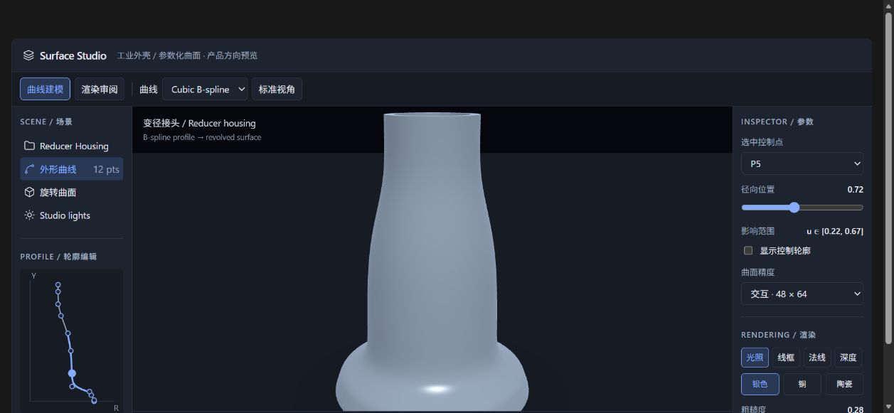

# Surface Studio

**Status: runnable WebGL 2 prototype. The native C++ / OpenGL application is planned and has not been implemented.**

A curve-driven 3D modeling and rendering workbench exploring the connection between Bézier / B-spline profiles, revolved surfaces, indexed meshes, lighting and depth testing.



This is an independent portfolio project prepared with AI assistance. Geometry is synthetic; no employer code or customer models are included.

## Run locally

Clone this repository and, with Python 3 installed, run:

```bash
python -m http.server 8000 --bind 127.0.0.1
```

Open **http://127.0.0.1:8000/** in a modern browser with WebGL 2. No npm install, remote API, model download, or graphics SDK is required for the prototype. The exported page includes its UI wrapper and icons. It also works by opening `index.html` directly when local-file browser policies permit.

## Implemented in the prototype

- Cubic Bézier evaluation using de Casteljau and clamped cubic B-spline evaluation using de Boor.
- Editable radial control points and visualization of the selected B-spline control point's support interval.
- A revolved hollow housing with indexed outer/inner walls, end rings and generated normals.
- Uniform sampling presets, orbit camera, zoom, material tint and specular roughness controls.
- Lit, wireframe, normal and linear-depth display modes; switchable depth testing.

These features are JavaScript / WebGL implementations. The current material shader is a simple lighting approximation, not a validated physically based renderer. Sampling is uniform, and the complete mesh is rebuilt after an edit. Project-file save/load, command-based undo, adaptive tessellation, NURBS and native GPU resource management are not implemented yet.

## Repository structure

```text
index.html                         Standalone runnable build
prototype/workbench.fragment.html Editable prototype source
prototype/standalone.template.html Offline export wrapper
tools/build_preview.py             Rebuild / verify the standalone build
tests/geometry.test.cjs             Numerical tests of the actual prototype algorithms
docs/DESIGN_CN.md                   Product scope and demonstration guide
docs/NATIVE_ROADMAP.md              Planned C++ / OpenGL milestones
docs/VALIDATION.md                  What has actually been checked
```

Rebuild after changing the fragment:

```bash
python tools/build_preview.py
python tools/build_preview.py --check
node --test tests/geometry.test.cjs
```

The build uses Python's standard library; tests use Node.js 22+ built-ins. No Codex installation is needed to run or rebuild this repository. CI checks build reproducibility, browser-script syntax, curve endpoints, agreement with independent basis formulas, and local support behavior.

## Native C++ direction

The intended native implementation uses C++17/20, OpenGL 3.3, Dear ImGui docking, GLM and CMake. The planned original core covers curve evaluation/derivatives, surface tessellation, normals, GPU ownership through move-only RAII objects, picking, command-based editing and revision-aware background rebuilds. See [the milestone checklist](docs/NATIVE_ROADMAP.md).

The first native milestone must demonstrate one complete operation: **edit a curve → rebuild the surface → upload the mesh → render it → undo and reload the saved document**. Native implementation claims will be added only with working source and validation evidence.

## References and licensing

- [Michigan Tech: de Casteljau](https://pages.mtu.edu/~shene/COURSES/cs3621/NOTES/spline/de-casteljau.html)
- [Michigan Tech: B-spline basis and local support](https://pages.mtu.edu/~shene/COURSES/cs3621/NOTES/surface/bspline-basis.html)
- [Khronos: depth testing](https://wikis.khronos.org/opengl/Depth_Test)

Original project code is MIT licensed. See [THIRD_PARTY.md](THIRD_PARTY.md) for the exported UI wrapper and icon attribution.
